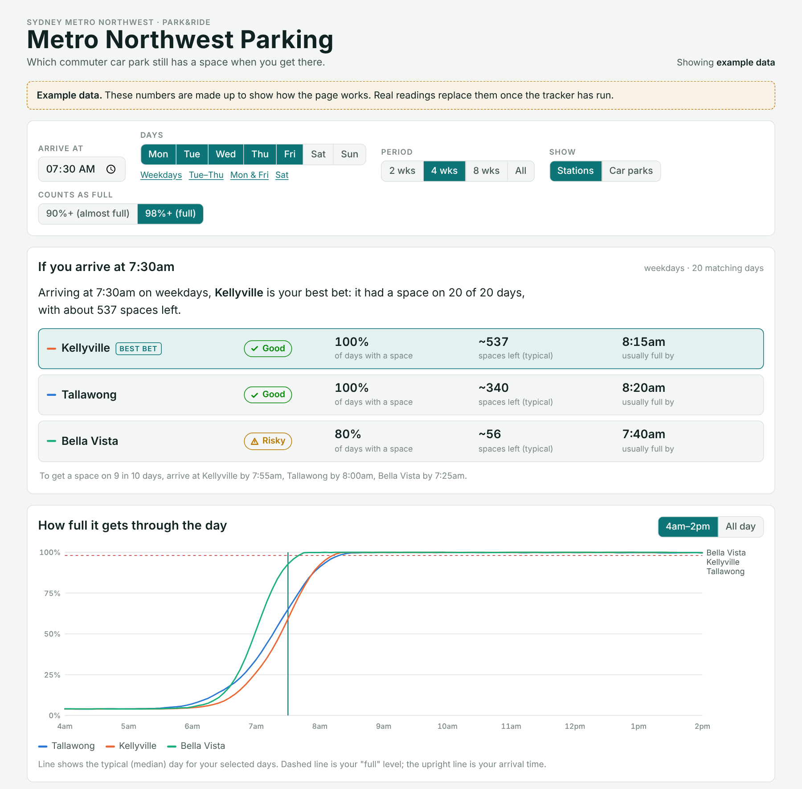
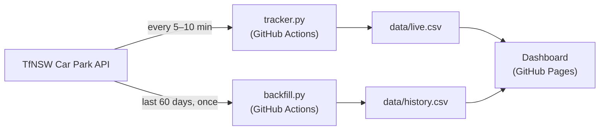

# Metro Northwest Parking

**Which Sydney Metro Northwest commuter car park still has a space when you get there?**

I drive to the Metro for work and kept wondering whether to aim for Tallawong, Kellyville or Bella Vista. This project records how full each Park&Ride car park is throughout the day, using Transport for NSW's open data, and turns it into a dashboard that answers one question: *if I arrive at 7:30am, where will I find a space?*

**[Open the live app →](https://adityaptl.github.io/metro-carpark-tracker/)** &nbsp;·&nbsp; installable on your phone's home screen


<sub>Screenshot uses the app's built-in example data.</sub>

## Features

- **Arrival verdict** — pick an arrival time and days; each station is ranked by how often it still had a space, with typical spaces left and the time it usually fills.
- **"Arrive by" times** — the latest arrival that still found a space on 9 in 10 days.
- **Daily fill curve** — the typical day's occupancy from 4am to 2pm (or all day), with your arrival time and "full" level marked.
- **Day-by-day table** — when each car park filled on each date, with days it filled before your arrival highlighted.
- **Weekday heatmap** — busiest times for each station or car park across the week.
- **Filters** — weekdays / Tue–Thu / Mon & Fri / Saturday, last 2, 4 or 8 weeks, station or individual car park, and what counts as full (90% or 98%).
- **Installable web app** — add it to your home screen; it opens offline with the last data it loaded.

## How it works



- **No server and nothing left running.** GitHub Actions runs the tracker on a schedule and commits each reading back into this repo. GitHub Pages serves the dashboard, which reads the CSV files directly.
- **Sampling** — every 5 minutes during weekday peaks (5–10am and 3–7pm) and every 10 minutes otherwise. The workflow fires every 5 minutes and the script decides whether a reading is due, working in Sydney time so daylight-saving changes need no edits.
- **History** — a one-off backfill pulls the previous 60 days from the API's history endpoint, so there's something to analyse from day one.

More detail on the design decisions and how each figure is calculated: **[docs/how-it-works.md](docs/how-it-works.md)**.

## Car parks tracked

| Station | Car parks (TfNSW facility ID) |
|---|---|
| Tallawong | P1 (26), P2 (27), P3 (28) |
| Kellyville | North (29), South (30) |
| Bella Vista | Park&Ride (31) |

Norwest has no Park&Ride car park in the feed. IDs come from the TfNSW Car Park API documentation v2.4; IDs 1–3 are retired "historical only" car parks and are excluded.

## Project layout

```
tracker.py                  takes one live reading → data/live.csv
backfill.py                 pulls past days from the history endpoint → data/history.csv
dashboard/app.html          the dashboard (single file, no build tools or libraries)
build_index.sh              wraps the dashboard into index.html for GitHub Pages
index.html, sw.js, app/     the installable web app (manifest, icons, offline support)
.github/workflows/          the scheduled tracker and the manual backfill
data/                       collected readings (written by the workflows)
docs/                       documentation and screenshot
```

## Run your own copy

1. Fork this repo.
2. Get an API token from the [TfNSW Open Data Hub](https://opendata.transport.nsw.gov.au) (profile → API Tokens).
3. **Settings → Secrets and variables → Actions → New repository secret**: name `TFNSW_API_KEY`, value = your token.
4. **Actions → Backfill past occupancy → Run workflow** to pull the last 60 days.
5. **Actions → Track car park occupancy → Run workflow** once to test; after that it runs on its own.
6. **Settings → Pages → Deploy from a branch → `main`, `/ (root)`** to publish the app.

To work on the dashboard locally: `python3 -m http.server` in the repo folder, then open `http://localhost:8000`. Edit `dashboard/app.html` and run `./build_index.sh` to regenerate `index.html`.

## Data format

`data/live.csv` and `data/history.csv` share one schema:

| column | meaning |
|---|---|
| `time` | Sydney local time, `YYYY-MM-DD HH:MM` |
| `facility_id` | TfNSW facility ID (see table above) |
| `spots` | total spaces reported by the feed |
| `occupied` | estimated cars parked (`occupancy.total`) |

## Limitations

- Occupancy comes from entry/exit counters, so it's an estimate; the app shows space counts with "~". Counters can drift or be reset after outages.
- GitHub's scheduler is best-effort, so readings can be a few minutes late or occasionally skipped.
- How far back the history endpoint goes isn't documented; the backfill takes whatever it returns.

## Built with

Python (standard library only) · GitHub Actions · GitHub Pages · plain HTML, CSS and JavaScript with hand-drawn SVG charts · [Transport for NSW Open Data](https://opendata.transport.nsw.gov.au)

## Licence

Code: [MIT](LICENSE). Car park data: © Transport for NSW, used under the Open Data Hub terms.
